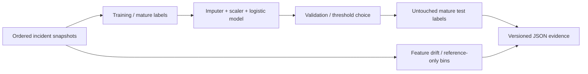

# Drift Sentinel

[](https://github.com/nazek52/drift-sentinel/actions/workflows/ci.yml)

A reproducible model-monitoring experiment for incident escalation. The interesting problem is not fitting a classifier: it is deciding what could have been known at each point in time, then detecting distribution changes without confusing them with model failure.

**Python · scikit-learn · delayed labels · temporal evaluation · drift diagnostics**

[Русский разбор](docs/INTERVIEW.ru.md) · [Model card](docs/model-card.md) · [Architecture](docs/architecture.md) · [Verification](docs/verification.md)

## Reproduce

Python 3.13+. Install in a virtual environment.

```sh
python -m pip install -r requirements-dev.txt
python -m sentinel demo --output artifacts/demo
python -m pytest -q
```

The demo generates 2,400 **synthetic** incident snapshots. They are not collected incidents or evidence of real predictive usefulness. A known covariate and relationship change is introduced in the final 20% to exercise monitoring.

Outputs:

| File | Purpose |
|---|---|
| `report.json` | Model/baseline metrics, delayed-label counts, PSI, bootstrap interval, limitations |
| `model.json` | Portable coefficients, medians, scaling parameters, feature order, threshold; no pickle |
| `predictions.csv` | Test-window probabilities; immature labels remain blank |
| `split-manifest.json` | Exact row indices used for each decision |
| `synthetic-incidents.csv` | Reproducible generated input |

## Evaluation protocol

1. Validate strictly increasing timestamps, feature ranges, binary labels, and label availability.
2. Split chronologically: first 60% training, next 20% validation, final 20% test.
3. At the training boundary, exclude labels not available yet. At the threshold-selection boundary, do the same for validation.
4. Fit median imputation, scaling, and logistic regression on training data only.
5. Select the threshold by validation F2, and select the prior baseline threshold on the same validation data.
6. Evaluate the untouched mature test labels; report immature ones separately.
7. Compare test feature distributions to training quantile bins with PSI, including missing-value and out-of-support behavior.



Metrics include average precision, ROC AUC, precision/recall, F2, Brier score, and TN/FP/FN/TP. Average precision is bootstrapped with a fixed seed. One-class test data produces `null` for ranking metrics instead of inventing a result.

## Bring your own data

```sh
python -m sentinel evaluate --input incidents.csv --output artifacts/custom --as-of 3000
```

Exact CSV columns: `timestamp,error_ratio,latency_ratio,queue_depth,cpu_ratio,deploy_age_hours,escalated,label_available_at`. Timestamps and label times are numeric in a shared unit; features must be measured at observation time, before escalation is known. Blank features are imputed. `as_of` defaults to the final observation timestamp and must be at least that timestamp. Require at least 300 rows, 30 mature labels per split, and both classes in training and validation. Timestamp units may be seconds or sequential observation ticks, but must be consistent.

## Limits that matter

PSI >= 0.2 is an investigation heuristic, not proof of concept drift. The bootstrap assumes independent observations; real correlated incidents need grouped or block resampling. F2 encodes a preference for recall, not a business-validated cost function. No automatic retraining or deployment is triggered. The model is not used to make real incident-management decisions. See the model card before interpreting any score.

The tests change future, unavailable labels and assert that the trained model, threshold, and evaluated metrics do not change. Portable inference is checked against sklearn probabilities. [Temporal split rationale](https://scikit-learn.org/stable/modules/generated/sklearn.model_selection.TimeSeriesSplit.html).

Personal, AI-assisted engineering project; [MIT](LICENSE).
